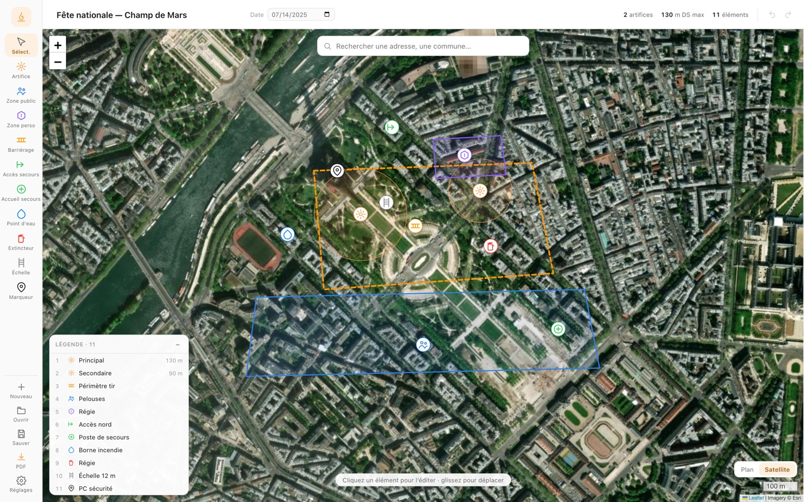
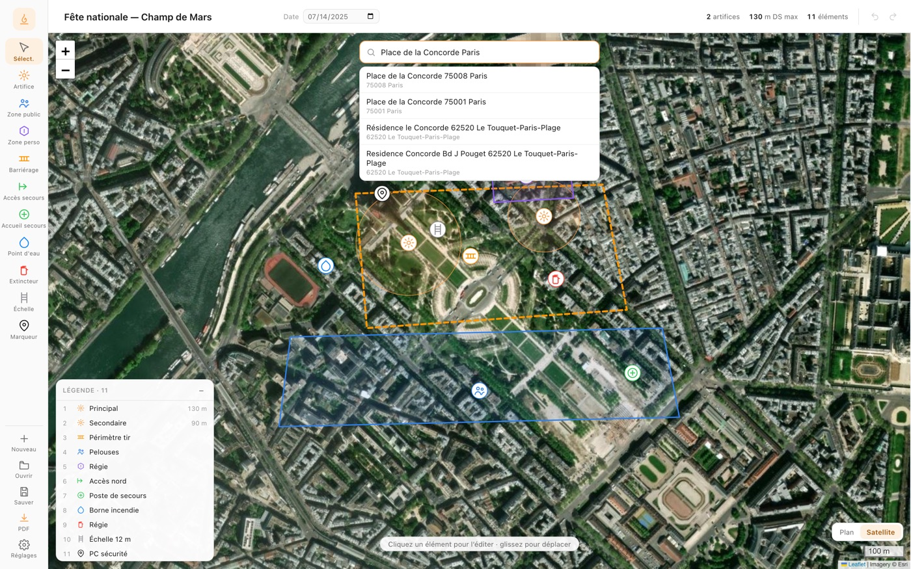
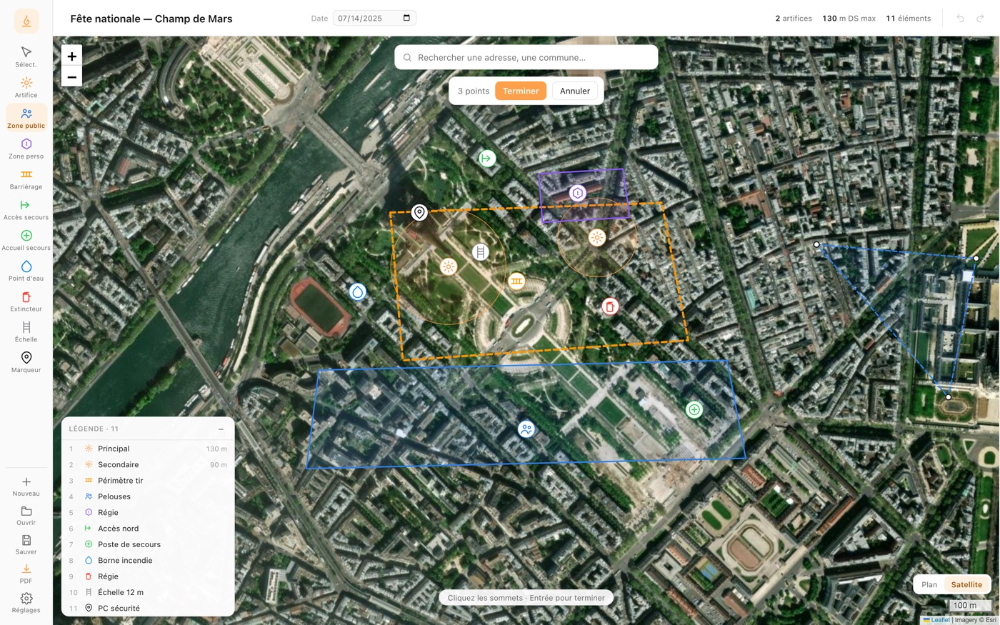
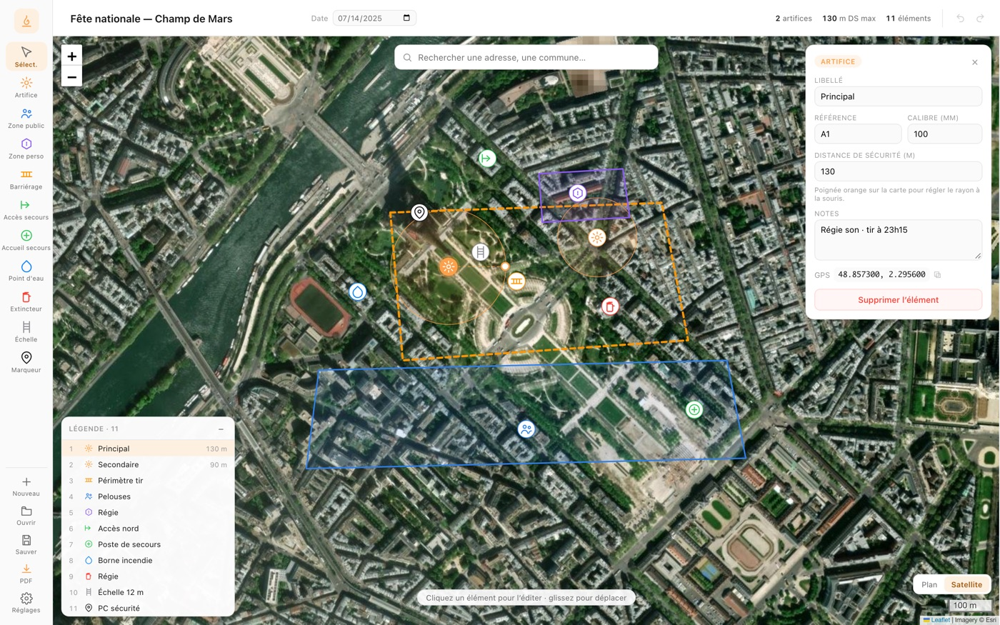
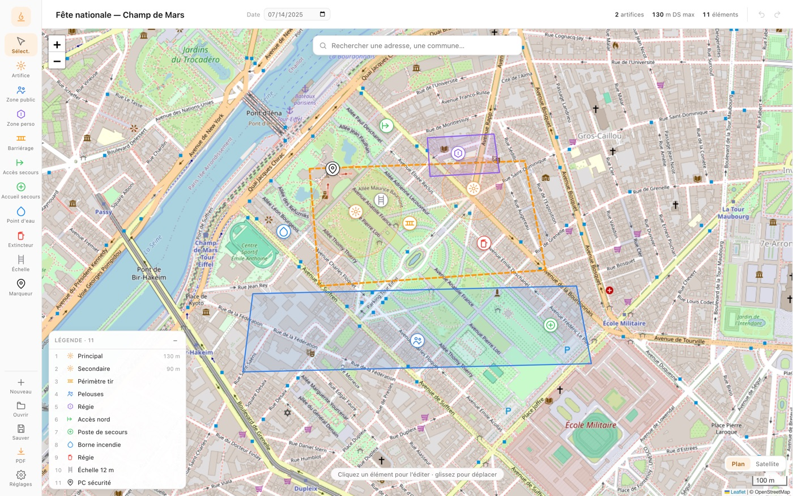
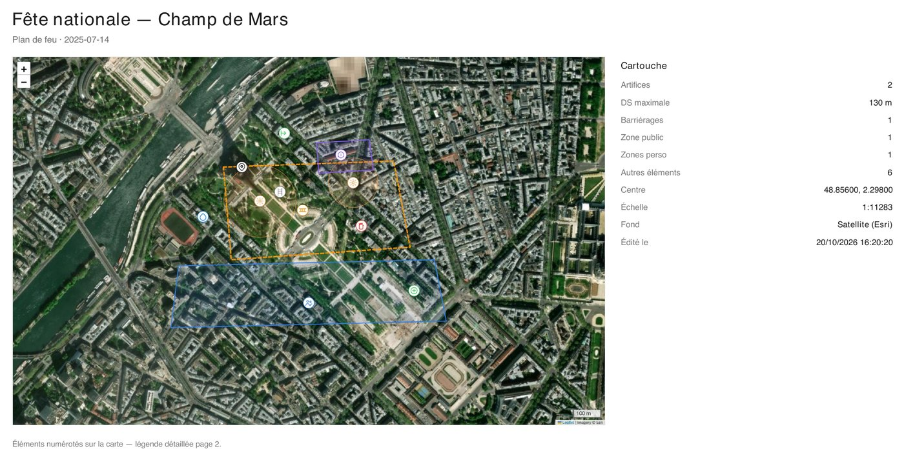
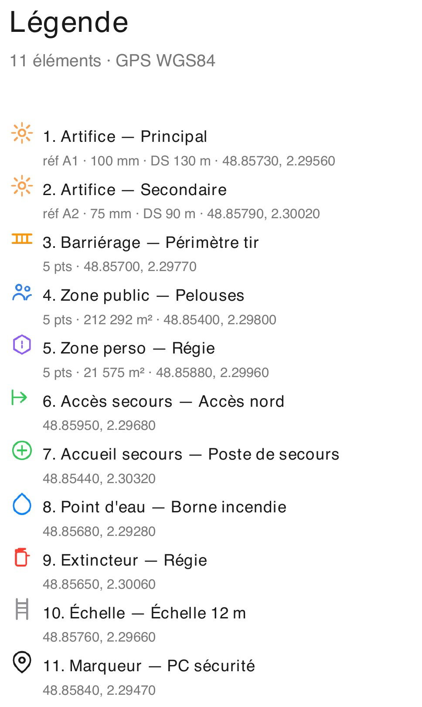
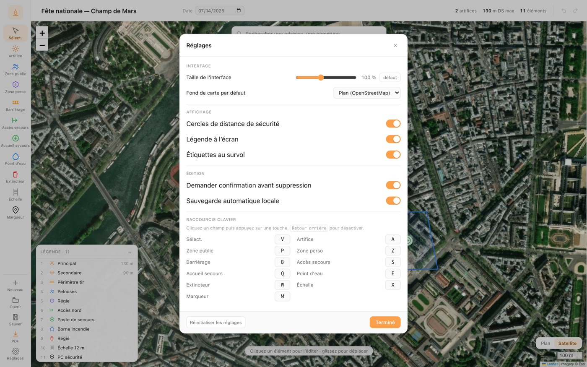

# Planete Plan

Générateur **local** de plans de disposition de feux d'artifice, sans compte,
sans serveur, sans envoi de données. Cartographie du site de tir, placement des éléments,
distances de sécurité, export PDF A4.



## Sommaire

- [Fonctionnalités](#fonctionnalités)
- [Démarrage](#démarrage)
- [Build](#build)
- [Tests](#tests)
- [Raccourcis](#raccourcis)
- [Limites assumées](#limites-assumées-v01)
- [Stack](#stack)

## Fonctionnalités

### Carte et positionnement

Fond **plan** (OpenStreetMap) ou **satellite** (Esri World Imagery), zoom / déplacement,
échelle métrique, et barre de recherche d'adresse (Base Adresse Nationale, puis Nominatim
hors France) qui recentre la carte sur le lieu trouvé.



### Éléments du plan

Dix outils dans le rail : artifice (avec cercle de distance de sécurité), barriérage,
zone public, **zone perso** (même tracé que la zone public, couleur et libellé
personnalisables), accès secours, accueil secours, point d'eau, extincteur, échelle,
marqueur libre. Le curseur de la carte prend l'icône et la couleur de l'outil actif.

Tracé des barriérages et des zones au clic (+ `Entrée` pour terminer, `Échap` pour
annuler) ; sommets déplaçables ensuite.



### Édition d'un élément

Libellé, référence, calibre, distance de sécurité, notes ; sélection au clic (ou depuis la
légende) ; déplacement à la souris. Le cercle de sécurité se règle directement sur la carte :
sélectionnez l'artifice, une poignée orange apparaît à l'est du point, glissez-la pour
ajuster la distance. Chaque élément porte son GPS (WGS84), copiable en un clic.



### Fond de carte

Le même plan, sur fond plan ou satellite selon le besoin (lisibilité du terrain / photo
aérienne).



### Export PDF A4 paysage

Page 1 = carte + cartouche (compteurs, DS max, centre, échelle, fond) ; page 2+ = légende
détaillée numérotée (réf, calibre, DS, aire des zones, GPS). L'image de carte est embarquée
dans le PDF : le document reste consultable hors ligne.

| Page 1 — carte et cartouche | Page 2 — légende détaillée |
| --- | --- |
|  |  |

### Réglages

Taille de l'interface (80 → 130 %), fond de carte par défaut, affichage des cercles de
sécurité / de la légende / des étiquettes, confirmation de suppression, sauvegarde
automatique locale, et **raccourcis clavier configurables**.



### Fichiers et historique

Plan `.planfeu.json` (enregistrer / ouvrir) + autosauvegarde locale ; annuler / rétablir sur
les 100 dernières modifications (`⌘Z` / `⇧⌘Z`), via deux boutons dans la barre de titre.

## Démarrage

```bash
npm install
npm run dev          # http://127.0.0.1:5173 (navigateur)
npm run tauri:dev    # fenêtre desktop Tauri
```

## Build

```bash
npm run build           # frontend seul (dist/)
npm run tauri:build     # .app/.dmg (macOS) ou .msi/.exe (Windows)
```

Partager l'app sur un autre Mac (blocage Gatekeeper, notarisation) : voir
[docs/partage-macos.md](docs/partage-macos.md).

## Tests

```bash
npm test        # node --test : conversions m/px, parsing distances, aire, échelle, géocodage
npm run check   # svelte-check (0 erreur attendu)
```

## Raccourcis

| Touche | Outil |
| --- | --- |
| `V` | Sélection |
| `A` | Artifice |
| `P` | Zone public |
| `Z` | Zone perso |
| `B` | Barriérage |
| `S` | Accès secours |
| `Q` | Accueil secours |
| `E` | Point d'eau |
| `W` | Extincteur |
| `X` | Échelle |
| `M` | Marqueur |
| `Entrée` | terminer le tracé (barriérage / zone) |
| `Échap` | annuler le tracé en cours, sinon désélectionner |
| `Suppr` | supprimer l'élément sélectionné |
| `⌘Z` / `Ctrl+Z` | annuler la dernière modification |
| `⇧⌘Z` / `Ctrl+Y` | rétablir |

Toutes les touches d'outil sont modifiables dans **Réglages → Raccourcis clavier**
(une touche déjà utilisée est retirée de l'outil précédent ; `Retour arrière` pour désactiver).

## Limites assumées (v0.1)

- La recherche d'adresse interroge un service en ligne (adresse.data.gouv.fr, Nominatim) :
  la carte et les tuiles demandent le réseau. Le PDF exporté, lui, reste consultable hors ligne.
- Pas de gestion multi-plans dans une session, pas d'i18n.
- Un seul fond par plan (plan ou satellite).

## Stack

Svelte 5 (runes) + Vite + TypeScript, Leaflet (carte), jsPDF (export), Tauri 2 (desktop).
Thème aligné sur la suite Pyroutils (accent `#FCA04B`, rail 76 px, Feather-style icons).
